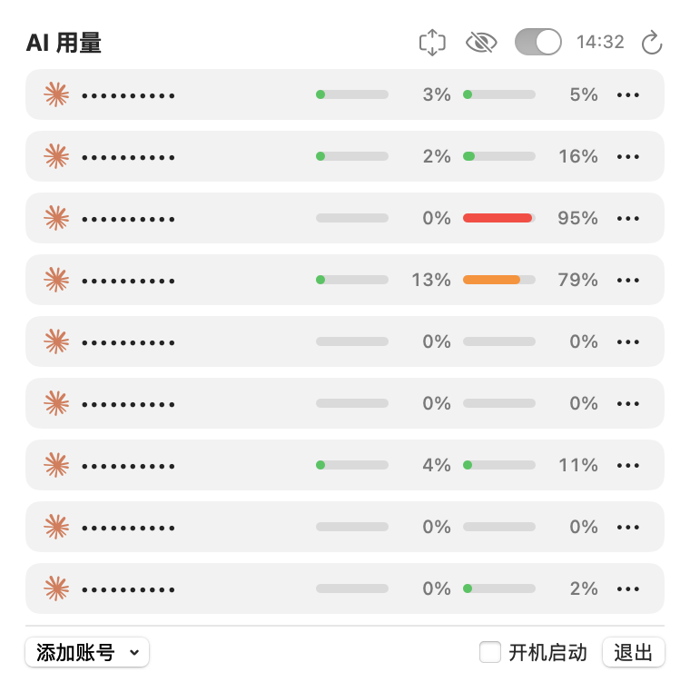

# Claude Usage Bar

macOS menu bar app that shows plan usage for several Claude Code and Codex accounts at once: 5-hour, weekly, and per-model weekly limits with reset countdowns.



## Install

```sh
make install   # builds dist/ClaudeUsageBar.app, copies it to /Applications, launches it
```

Requires macOS 14+ and a Swift 6 toolchain.

## Accounts

**添加账号 → Claude / Codex** opens the provider's OAuth page in the browser; pick the organization or workspace and approve. Accounts are keyed by Claude organization or ChatGPT account, so several under one email work.

- Claude requests only `user:profile` (usage and profile reads, no inference).
- Codex uses the Codex CLI's OAuth client, whose redirect is fixed to `127.0.0.1:1455` (fallback `1457`); a running `codex login` on those ports blocks it.

The app keeps its own refresh tokens in the login keychain (`com.nimrc.claude-usage-bar`) and never touches the Claude Code or Codex CLI credentials. Usage refreshes every 5 minutes and when the panel opens.

The eye switch blurs account names for screenshots. Drag a card onto another to reorder.

## CLI

```sh
/Applications/ClaudeUsageBar.app/Contents/MacOS/ClaudeUsageBar --status
```

Prints every account's limits. Read-only: it uses the stored access tokens and never refreshes them, so it cannot invalidate the running app's refresh tokens.

## Development

```sh
make build && make test
```

Provider logos are [simple-icons](https://simpleicons.org) SVGs (CC0) in `Resources/Logos`.
